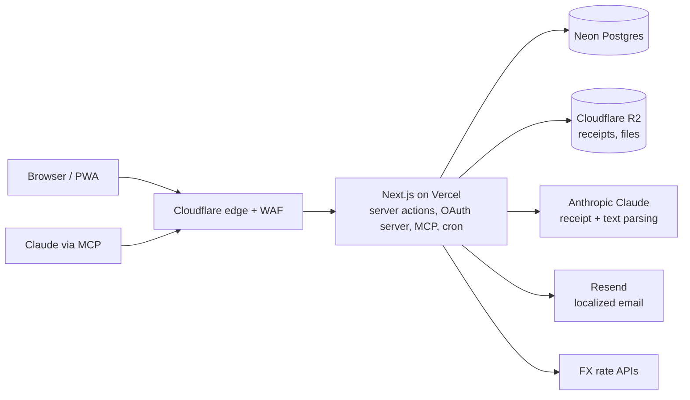

# PayUp: shared expenses that get split right, in any currency

**[Live](https://yopayup.com)** · Role: founder, product, design and engineering (solo, AI-assisted) · Aug–Sep 2026 ·
TypeScript · Next.js · Postgres · Claude API · Cloudflare · Vercel

*A household circle on desktop and the overview on the installable mobile app (demo data, fictional people).*

## TL;DR
- **Customer problem:** shared households split money across currencies, receipts and unequal contributions, and apps built
  for a weekend trip break down.
- **Workflow and agents:** one typed sentence or a receipt photo becomes a correctly split expense (162 currencies, 5
  languages), and an AI assistant such as Claude can run the household's admin through **17 MCP tools** behind PayUp's own
  OAuth server: 7 read tools and 10 that file or edit. It can read and file, never settle.
- **Why the agents must be safe:** an AI that writes to a ledger can invent a person or an amount, or run up a bill. So every
  AI field is re-validated, spend is capped before the call, and no tool exists that finishes anything (settle, mark done,
  confirm). A test asserts those tools are absent.
- **Built like a product, not a demo:** 377 commits and 85 merged pull requests in 25 active days, 60 test files gated in CI.

## The problem
Splitting apps handle a weekend trip but strain under a shared household: rent in one currency, a holiday in another,
receipts with tax and tip, and one person quietly covering more than their share.

## The agents at work
- **Entry agent.** "Paid $63.24 for groceries at Whole Foods, split with the flat" fills in amount, category, place and
  group. A receipt photo or PDF becomes line items each person claims. The model may answer "not sure" instead of guessing,
  and the output is schema-checked and re-validated, so a hallucinated person or amount is never written.
- **Assistant over MCP.** Claude connects through PayUp's own OAuth server (dynamic client registration, PKCE, rotating
  refresh tokens, audience binding). Every tool checks circle membership, including the fan-out across all circles, which
  is the easiest place to leak by accident. `list_upcoming` merges payments and chores onto one timeline so the assistant
  does not have to reconcile two lists. Invites it creates stay pending until a person accepts.
- **Containment before the call.** The file's real type is checked from its bytes, daily per-user limits apply, and
  per-user and platform-wide monthly spend ceilings are charged at worst case before the call, then reconciled.

## Approach and key decisions
- **Record the money, never move it.** PayUp keeps the ledger; people settle wherever they already pay each other. No
  payment licensing, no custody risk, faster to ship.
- **Balances are computed on read, never stored,** so the ledger can't drift.
- **Each expense freezes its own exchange rate;** conversion is display-only and netting never crosses currencies.
- **AI fills in, humans decide.** The model may answer "not sure" rather than guess, every field is re-validated, and
  anything final (like settling a debt) stays a human action.
- **Cost containment before the AI call, not after:** spend is charged at worst case up front, then reconciled.

## What it does
- **Natural-language and receipt entry:** "Paid $63.24 for groceries at Whole Foods, split with the flat" fills in
  amount, category, place and group; a receipt photo or PDF becomes line items each person claims.
- **Five split methods** (equal, exact, percent, shares, by item), plus **Smart Settle**, which nets a tangle of IOUs
  down to the fewest payments.
- **162 currencies and 5 languages,** each amount kept in the currency it was paid in; emails in the recipient's language.
- **Households, not just trips:** chores, recurring payments, a shared shopping list, and gentle nudges when one person
  is fronting most of a category.
- **Works with Claude:** a built-in connector lets an AI assistant read balances and file expenses or chores.

*One sentence in, a filled form out: amount, group, category and description, ready to check.*

*A receipt split by item: each line goes to whoever claimed it, with tax spread proportionally.*

*A household circle: who owes whom, expenses, chores and the shopping list in one place.*

*The shared shopping list on a phone, sorted into aisles automatically.*

## Three hard problems
**1. Money that is right in every currency.** An audit found four display bugs that summed or dropped amounts across
currencies. The fix was a rule, not a patch: frozen per-expense rates, display-only conversion, no cross-currency
netting, and missing rates shown as missing rather than guessed. Currency rounding rules ship with the app so server and
browser always agree. Each bug is pinned by a regression test.

*Activity across circles, every amount kept in the currency it was paid in.*

**2. Putting a paid AI call behind a public form.** Each request passes layered containment: the file's real type is
checked from its bytes, daily per-user limits apply, and per-user and platform-wide monthly spend ceilings are charged
before the call. Structured output plus re-validation means a hallucinated person or amount is never written.

**3. Letting an AI assistant operate the app safely.** PayUp is its own OAuth authorization server exposing 17 Model
Context Protocol tools, each gated on group membership. When tokens were issued but calls never arrived, the cause was
an edge bot rule silently blocking one user agent before it reached the app; a narrowly scoped firewall exception fixed it.

*Settling a trip: Smart Settle has already netted the debts, separately for each currency.*

## Architecture

One codebase serves a desktop dashboard and an installable, thumb-first mobile PWA.

## Quality and security
Sign-in by passkey, magic link, or password with TOTP. Cloudflare WAF and rate limits at the edge, membership checks on
every group action, AI spend ceilings, 60 test files and Playwright visual regression in CI.

## Results
- 377 commits on `main`, 85 merged pull requests, about 73k lines of TypeScript over 25 active days.

---
Code available on request.
